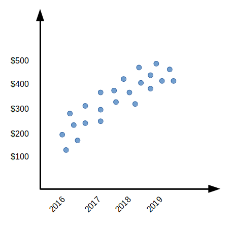
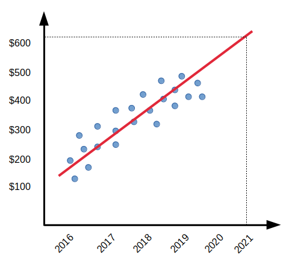
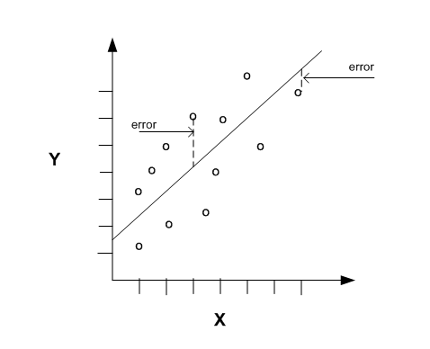

# Simple Linear Regression

## Table of Contents
- [Overview](#overview)
- [Key Concepts](#key-concepts)
- [Model Building and Interpretation](#model-building-and-interpretation)
- [References](#references)

## Overview
Simple linear regression is a statistical approach to summarize and examine the relationship between two quantitative (continuous) variables. It is a foundational technique in supervised learning.

## Key Concepts
- **Independent variable**: Data that can be controlled directly.
- **Dependent variable**: Data that cannot be controlled directly.
- *Example*: To study whether caffeine affects appetite, the presence/absence of caffeine is the independent variable, and hunger level is the dependent variable.

- **Linear regression models** provide a simple yet effective approach to supervised learning.
- **Linear**: Organized or extended in a straight or almost straight line. Linear regression assumes a straight-line relationship between dependent and independent variables.
- **Equation of a line**: $y = mx + c$ (or $y = w_0 + w_1x$)
  - $y$: Dependent variable (predicted value)
  - $x$: Independent variable (input feature)
  - $m$: Slope (angle of the line)
  - $c$: Intercept (where the line crosses the y-axis)

## Model Building and Interpretation
- **Training data** is used to create the model; **testing data** evaluates model performance.
- The goal is to find the line that best fits the data points.

  

- In machine learning, the convention is: `h(X) = W0 + W1*X`, where `W0` and `W1` are weights, `X` is the input, and `h(X)` is the prediction.
- The best-fitting line minimizes the cost function, commonly the **Squared Error Cost**.

  

  

- Training involves finding weights (`W0`, `W1`) that minimize the cost.

## References
- [Scikit-learn Linear Regression Documentation](https://scikit-learn.org/stable/modules/generated/sklearn.linear_model.LinearRegression.html)
- [Wikipedia: Simple Linear Regression](https://en.wikipedia.org/wiki/Simple_linear_regression)

