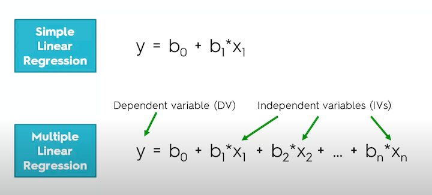

# Multiple Linear Regression

## Table of Contents
- [Overview](#overview)
- [Model-Building Methods](#model-building-methods)
- [Visual Formula](#visual-formula)
- [Notes](#notes)

## Overview
Multiple linear regression fits a linear equation to observed data to model the relationship between two or more explanatory (independent) variables and a response (dependent) variable. Each observation consists of values for the independent variables \(x_1, x_2, \ldots, x_n\) and the dependent variable \(y\).

## Model-Building Methods
There are several approaches to building multiple linear regression models:

1. **All-in**: Include all candidate variables in the model.
2. **Backward Elimination**: Start with all variables, remove the least significant one at each step.
3. **Forward Selection**: Start with no variables, add the most significant one at each step.
4. **Bidirectional Elimination**: Combine forward selection and backward elimination.
5. **Score Comparison**: Compare models using statistical metrics (e.g., AIC, BIC, adjusted R²).

## Visual Formula

  

## Notes
- Libraries such as `scikit-learn` (Python) and `statsmodels` (Python) or `lm()` in R can automate model selection and fitting.
