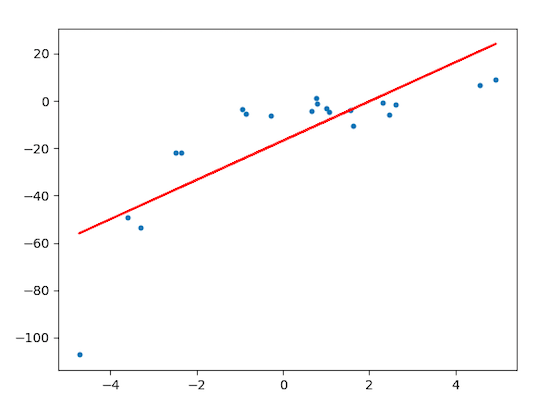
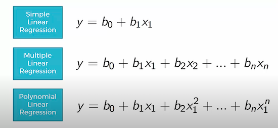
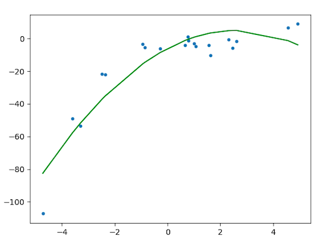
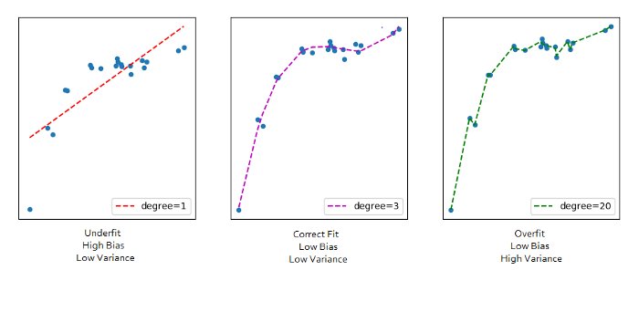

# Polynomial Regression

> Polynomial regression extends linear regression by modeling the relationship between the independent variable(s) and the dependent variable as an nth degree polynomial. This allows the model to capture non-linear patterns in the data.

## Table of Contents

- [Overview](#overview)
- [Polynomial Expression](#polynomial-expression)
- [Model Fitting Example](#model-fitting-example)
- [Model Comparison](#model-comparison)
- [Further Reading](#further-reading)

## Overview

Linear regression sometimes cannot capture complex patterns in data, leading to underfitting. To address this, we can increase the model's complexity by introducing polynomial features—powers of the original features—enabling the model to fit a higher-order equation.

    

## Polynomial Expression

A polynomial regression model of degree *n* can be expressed as:

    

## Model Fitting Example

Fitting a polynomial regression model (degree = 2):

    

## Model Comparison

Comparing the fit of models with different polynomial degrees:

    

## Further Reading

- [Polynomial Regression — Towards Data Science](https://towardsdatascience.com/polynomial-regression-bbe8b9d97491)
