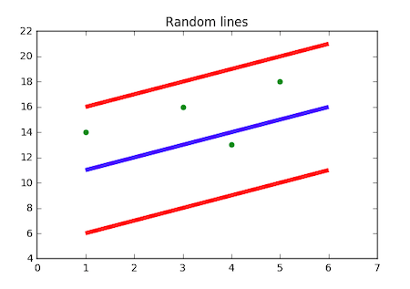

# Support Vector Regression (SVR)

> Support Vector Regression (SVR) is a powerful regression technique that leverages the principles of Support Vector Machines to predict continuous values, allowing for flexible error margins and robust performance on non-linear data.

## Table of Contents
- [Overview](#overview)
- [Key Terminology](#key-terminology)
- [How SVR Works](#how-svr-works)
- [Visualization](#visualization)
- [Further Reading](#further-reading)

## Overview

In most linear and polynomial regression models, the objective is to minimize the sum of squared errors. SVR, however, introduces the concept of an acceptable error margin (epsilon), seeking a function that fits the data within this margin and is as flat as possible. This makes SVR especially useful for datasets where some error tolerance is acceptable and for capturing non-linear relationships using kernel tricks.

## Key Terminology

1. **Kernel**: A function that transforms data into higher dimensions to make it possible to perform linear separation or regression in that space.
2. **Hyperplane**: In SVM, this is the decision boundary; in SVR, it is the regression line (or surface) that predicts the target value.
3. **Boundary Lines (Margins)**: Two lines that define the margin of tolerance (epsilon) within which errors are ignored by the model.
4. **Support Vectors**: Data points closest to the margin boundaries. These points are critical in defining the position and orientation of the hyperplane.

## How SVR Works

- The SVR algorithm tries to fit the best line (or hyperplane) within a predefined margin of tolerance (epsilon) from the actual data points.
- Only the data points that fall outside this margin (the support vectors) influence the model.
- By using different kernels (e.g., linear, polynomial, RBF), SVR can model both linear and non-linear relationships.

## Visualization

    

- **Blue line**: Hyperplane (regression line)
- **Red lines**: Margin boundaries (epsilon)
- **Green dots**: Data points

All points within the red boundary lines are considered within the acceptable error margin. The best-fit line is the one that maximizes the number of points within this margin while remaining as flat as possible.

**Mathematical Intuition:**
- SVR tries to fit a function $f(x)$ so that most data points fall within a tube of width $2\epsilon$ around it.
- Only points outside this tube (support vectors) affect the model.
- Kernel functions allow SVR to fit nonlinear relationships by mapping data to higher dimensions.

## Further Reading

- Chapter 4: Support Vector Regression, from *Efficient Learning Machines: Theories, Concepts, and Applications for Engineers and System Designers* by Mariette Awad & Rahul Khanna (2015) [[PDF]](readme_assets/support_vector_regression.pdf)
- [scikit-learn: SVR Documentation](https://scikit-learn.org/stable/modules/generated/sklearn.svm.SVR.html)
