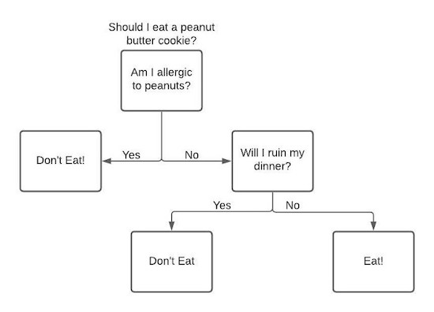
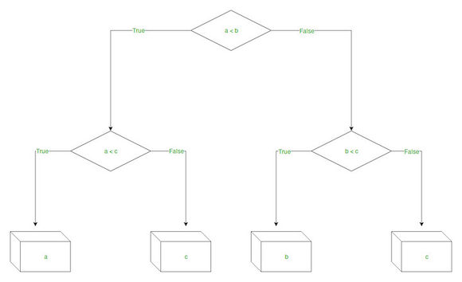

# Decision Tree Regression

> Decision Tree Regression is used when we are trying to predict an output variable that is continuous.

## Table of Contents

- [Overview](#overview)
- [How Decision Trees Work](#how-decision-trees-work)
- [Visual Examples](#visual-examples)
- [How Splitting Works](#how-splitting-works)
- [Further Reading](#further-reading)

## Overview

Decision Tree Regression is a non-parametric supervised learning method used for predicting continuous values. It works by splitting the data into subsets based on feature values, recursively, to minimize prediction error.

## How Decision Trees Work

A decision tree makes decisions (splits) based on input features until certain criteria are met. For example, consider a simple decision tree for deciding whether to eat a peanut butter cookie:

  

- The tree splits on variables (e.g., allergy, ruining dinner) to reach a decision.
- In real datasets with many variables, algorithms like ID3 use entropy and information gain to choose the best splits.

There are three types of nodes in a decision tree:
- **Root Node**: Represents the entire dataset.
- **Internal Nodes**: Represent features and decision rules.
- **Leaf Nodes**: Represent outcomes.

  

## How Splitting Works

- For regression, the tree fits a model to the target variable using each independent variable.
- It splits the data at points that minimize the sum of squared errors (SSE).
- The process continues recursively, always choosing the split with the lowest SSE.
- Concepts like **information entropy** and **information gain** are key to understanding how splits are chosen.

## Further Reading

- [Machine Learning: Decision Tree Regression (Medium)](https://medium.com/analytics-vidhya/machine-learning-decision-tree-regression-ff8563ffaf52)
- [Entropy and Information Gain (TDS)](https://towardsdatascience.com/decision-trees-explained-entropy-information-gain-gini-index-ccp-pruning-4d78070db36c)
- [Entropy and Information Gain in Decision Trees (TDS)](https://towardsdatascience.com/entropy-and-information-gain-in-decision-trees-c7db67a3a293)
