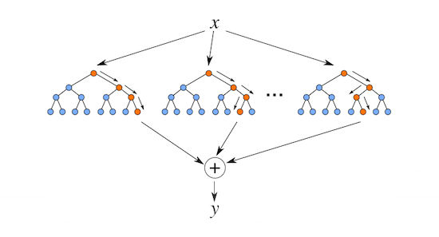

# Random Forest Regression

> Random Forest Regression is an ensemble learning method that builds multiple decision trees and merges their results for more accurate and stable predictions.

## Table of Contents
- [Overview](#overview)
- [How It Works](#how-it-works)
- [Ensemble Learning](#ensemble-learning)
- [Advantages](#advantages)
- [References](#references)

## Overview
Random Forest Regression creates a 'forest' of decision trees, each trained on a random subset of the data and features. The final prediction is the average of all tree predictions, which improves accuracy and reduces overfitting compared to a single decision tree.

## How It Works

- Each tree is trained on a different bootstrap sample (random sample with replacement) of the data.
- At each split in a tree, a random subset of features is considered.
- Each tree makes its own prediction.
- The predictions are averaged to produce the final result.

  

**Mathematical Intuition:**
- Each tree is trained on a different random sample, and at each split, a random subset of features is considered.
- The ensemble prediction is the mean of all tree outputs, reducing variance and improving generalization.

## Ensemble Learning

Ensemble learning combines predictions from multiple models to improve overall performance. There are two main types:

1. **Boosting**: Sequentially builds models, each focusing on the errors of the previous one. Example: AdaBoost, Gradient Boosting.
2. **Bagging (Bootstrap Aggregation)**: Builds models independently using random samples of the data, then aggregates their predictions. Random Forest is a bagging method.

## Advantages
- Handles both regression and classification tasks.
- Reduces overfitting compared to individual decision trees.
- Can handle large datasets with higher dimensionality.
- Provides feature importance estimates.

## References
- [Random Forest Regression on Medium](https://medium.com/swlh/random-forest-ac5227dabb08)
- [Scikit-learn: Random Forest Regression](https://scikit-learn.org/stable/modules/generated/sklearn.ensemble.RandomForestRegressor.html)
