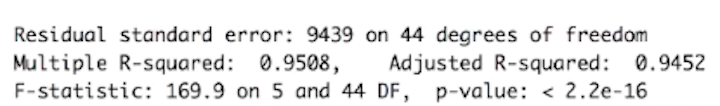

# Evaluating Regression Models: Performance & Model Selection

> Evaluate, compare, and select regression models using standard metrics and practical templates.

## Table of Contents
- [Overview](#overview)
- [Performance Evaluation Metrics](#performance-evaluation-metrics)
- [Model Selection](#model-selection)
- [Example Output](#example-output)
- [References & Further Reading](#references--further-reading)

## Overview

This module provides guidance and code templates for evaluating regression model performance and selecting the best model for your data. It covers key metrics, practical usage in Python and R, and links to further resources.

## Performance Evaluation Metrics

Common metrics for evaluating regression models include:

- **Mean Absolute Error (MAE):** Average absolute difference between predicted and actual values. Intuitive and robust to outliers.
- **Root Mean Square Error (RMSE):** Square root of the average squared differences. Penalizes larger errors more than MAE.
- **R Squared ($R^2$):** Proportion of variance in the target explained by the model. Ranges from 0 (no fit) to 1 (perfect fit).
- **Adjusted R Squared:** Like $R^2$, but adjusts for the number of predictors, discouraging overfitting.

> **Tip:** Higher R² and Adjusted R² values generally indicate a better fit.

For detailed explanations, see:
- [Evaluate the Performance of a Regression Model (OpenClassrooms)](https://openclassrooms.com/en/courses/6401081-improve-the-performance-of-a-machine-learning-model/6519016-evaluate-the-performance-of-a-regression-model)
- [R Squared vs Adjusted R Squared (Analytics India Magazine)](https://analyticsindiamag.com/r-squared-vs-adjusted-r-squared/)

## Model Selection

**Mathematical Intuition:**
- Evaluation metrics quantify how well a model's predictions match actual values, helping to compare and select models.
- Metrics like MAE, RMSE, and $R^2$ capture different aspects of prediction error and model fit.

## Example Output

## References & Further Reading

- [Evaluate the Performance of a Regression Model (OpenClassrooms)](https://openclassrooms.com/en/courses/6401081-improve-the-performance-of-a-machine-learning-model/6519016-evaluate-the-performance-of-a-regression-model)
- [R Squared vs Adjusted R Squared (Analytics India Magazine)](https://analyticsindiamag.com/r-squared-vs-adjusted-r-squared/)
