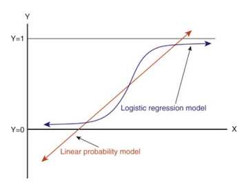

# Logistic Regression Classification

> This lesson demonstrates how to preprocess data and apply Logistic Regression for classification tasks in both Python and R.

## Table of Contents

- [Overview](#overview)
- [Theory](#theory)
  - [What is Logistic Regression?](#what-is-logistic-regression)
  - [Sigmoid Function](#sigmoid-function)
  - [Linear vs Logistic Regression](#linear-vs-logistic-regression)
- [References](#references)

## Overview

Logistic Regression is a fundamental algorithm for classification problems, where the goal is to assign discrete classes (e.g., spam/not spam, fraud/not fraud) to observations based on input features.

## Theory

### What is Logistic Regression?

Logistic Regression is a predictive analysis algorithm based on probability, used for classification problems. Unlike linear regression, which predicts continuous values, logistic regression predicts categorical outcomes.

### Sigmoid Function

The Sigmoid function is used to map predicted values to probabilities between 0 and 1:

**Mathematical Intuition:**
- Logistic regression models the probability that a given input belongs to a particular class using the logistic (sigmoid) function:
  $$ \sigma(z) = \frac{1}{1 + e^{-z}} $$
  where $z = w^T x + b$.
- The output is always between 0 and 1, making it suitable for probability estimation.
- The model is trained by maximizing the likelihood (or minimizing the log-loss) of the observed data.

### Linear vs Logistic Regression

- **Linear Regression**: Predicts a continuous dependent variable using independent variables.
- **Logistic Regression**: Predicts a categorical dependent variable using independent variables.

## References

- [Scikit-learn Logistic Regression Documentation](https://scikit-learn.org/stable/modules/generated/sklearn.linear_model.LogisticRegression.html)
- [R glm Function Documentation](https://stat.ethz.ch/R-manual/R-devel/library/stats/html/glm.html)
- [Linear vs Logistic Regression in Machine Learning](https://www.javatpoint.com/linear-regression-vs-logistic-regression-in-machine-learning)
