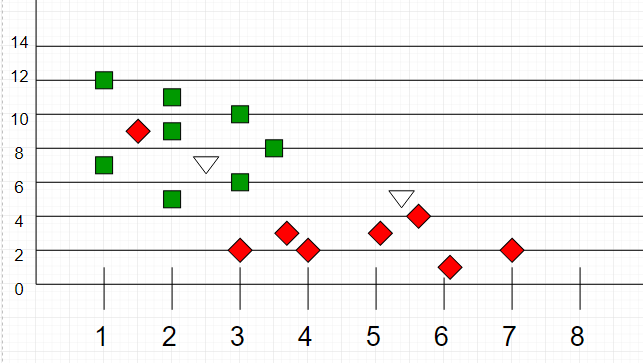

# K Nearest Neighbors (KNN) Classification

## Table of Contents

- [Overview](#overview)
- [Theory](#theory)
  - [What is KNN?](#what-is-knn)
  - [KNN Algorithm Steps](#knn-algorithm-steps)
- [References](#references)

## Overview

K Nearest Neighbors (KNN) is a simple, intuitive algorithm for classification problems, where the goal is to assign discrete classes (e.g., spam/not spam, fraud/not fraud) to observations based on their proximity to other labeled data points.

## Theory

### What is KNN?

KNN assumes that similar things exist in close proximity—i.e., similar data points are near each other in feature space. A new data point is classified based on the majority class among its K nearest neighbors.

A point close to a cluster of points classified as ‘Red’ has a higher probability of being classified as ‘Red’.

### KNN Algorithm Steps

1. Select the value of K.
2. Calculate the Euclidean distance from the unclassified sample to all other points.
3. Identify the K nearest neighbors.
4. Count the number of data points in each class among the neighbors.
5. Assign the new data point to the class with the most neighbors.

**Mathematical Intuition:**
- The distance metric (commonly Euclidean distance) is used to measure similarity between points. For two points $x = (x_1, x_2, ..., x_n)$ and $y = (y_1, y_2, ..., y_n)$, the Euclidean distance is:
  $$ d(x, y) = \sqrt{\sum_{i=1}^n (x_i - y_i)^2} $$
- The algorithm does not learn an explicit model; instead, it stores the entire training dataset and makes predictions at query time (a type of "instance-based" or "lazy" learning).
- The choice of $K$ (number of neighbors) affects bias-variance tradeoff: small $K$ can be sensitive to noise, large $K$ can smooth out class boundaries.

## References

- [K-Nearest Neighbors (GeeksforGeeks)](https://www.geeksforgeeks.org/k-nearest-neighbours/)
- [KNN Algorithm (Towards Data Science)](https://towardsdatascience.com/machine-learning-basics-with-the-k-nearest-neighbors-algorithm-6a6e71d01761)
- [scikit-learn KNeighborsClassifier Documentation](https://scikit-learn.org/stable/modules/generated/sklearn.neighbors.KNeighborsClassifier.html)
- [R class::knn Documentation](https://www.rdocumentation.org/packages/class/versions/7.3-22/topics/knn)
