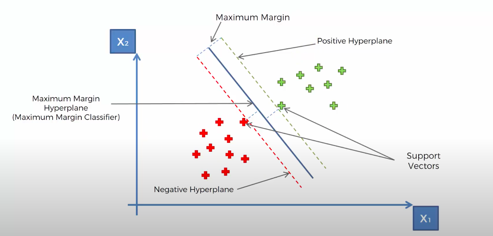

# Support Vector Machine (SVM) Classification

## Table of Contents

- [Overview](#overview)
- [Theory](#theory)
  - [What is SVM?](#what-is-svm)
  - [SVM Algorithm Steps](#svm-algorithm-steps)
- [References](#references)

## Overview

Support Vector Machine (SVM) is a powerful supervised learning algorithm used for classification tasks. The goal of SVM is to find a hyperplane in an N-dimensional space that distinctly classifies the data points (e.g., spam/not spam, fraud/not fraud).

## Theory

### What is SVM?

SVM aims to find the optimal hyperplane that separates data points of different classes with the maximum margin. There may be multiple possible hyperplanes, but the best one maximizes the distance between the nearest points of each class (support vectors).

Hyperplanes are decision boundaries that help define the data points. Data points falling on either side of the hyperplane are assigned to different groups.

### SVM Algorithm Steps

1. Select the kernel and set SVM parameters.
2. Map data to a higher-dimensional space (if needed).
3. Find the optimal hyperplane that separates the classes with the maximum margin.
4. Classify new data points based on which side of the hyperplane they fall.

**Mathematical Intuition:**
- The margin is the distance between the hyperplane and the closest data points from each class (support vectors).
- The optimal hyperplane is the one that maximizes this margin, which can be formulated as a convex optimization problem.
- For linearly separable data, the decision boundary is $w^T x + b = 0$.
- For non-linearly separable data, SVM can use kernel functions to project data into higher dimensions.

## References

- [Support Vector Machine Introduction (Towards Data Science)](https://towardsdatascience.com/support-vector-machine-introduction-to-machine-learning-algorithms-934a444fca47)
- [SVM Classification (TutorialsPoint)](https://www.tutorialspoint.com/machine_learning_with_python/machine_learning_with_python_classification_algorithms_support_vector_machine.htm)
- [scikit-learn SVC Documentation](https://scikit-learn.org/stable/modules/generated/sklearn.svm.SVC.html)
- [R e1071::svm Documentation](https://www.rdocumentation.org/packages/e1071/topics/svm)
