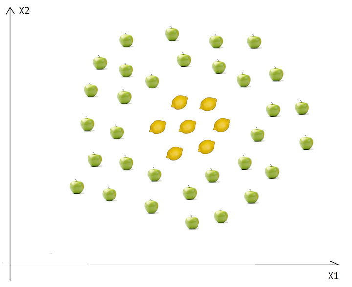
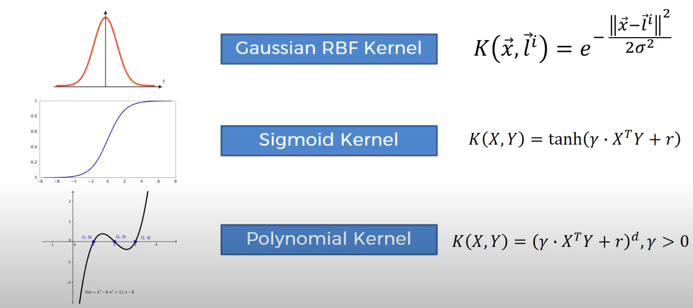

# Kernel Support Vector Machine (SVM) Classification

## Table of Contents

- [Overview](#overview)
- [Theory](#theory)
  - [Motivation for Kernel SVM](#motivation-for-kernel-svm)
  - [Mapping to Higher Dimensions](#mapping-to-higher-dimensions)
  - [Kernel Types](#kernel-types)
- [References](#references)

## Overview

Kernel Support Vector Machine (SVM) extends the basic SVM algorithm to handle non-linearly separable data by mapping it to higher dimensions using kernel functions. This lesson provides code and explanations for implementing Kernel SVM in both Python and R.

## Theory

### Motivation for Kernel SVM

If a dataset is not linearly separable in its current dimensions, we can map it to a higher-dimensional space where it may become separable.

In the example above, we cannot find a straight line to separate apples from lemons.

**Mathematical Intuition:**
- Kernel functions (e.g., polynomial, RBF/Gaussian) implicitly compute dot products in higher-dimensional spaces without explicitly transforming the data (the "kernel trick").
- This allows SVMs to create complex, nonlinear decision boundaries efficiently.

### Mapping to Higher Dimensions

Instead of blindly adding dimensions, we use kernel functions to transform the space and create separability.

### Kernel Types

Different kernel functions can be used to map data into higher dimensions:

## References

- [Major Kernel Functions in SVM (GeeksforGeeks)](https://www.geeksforgeeks.org/major-kernel-functions-in-support-vector-machine-svm/)
- [scikit-learn SVC Documentation](https://scikit-learn.org/stable/modules/generated/sklearn.svm.SVC.html)
- [R e1071::svm Documentation](https://www.rdocumentation.org/packages/e1071/topics/svm)
