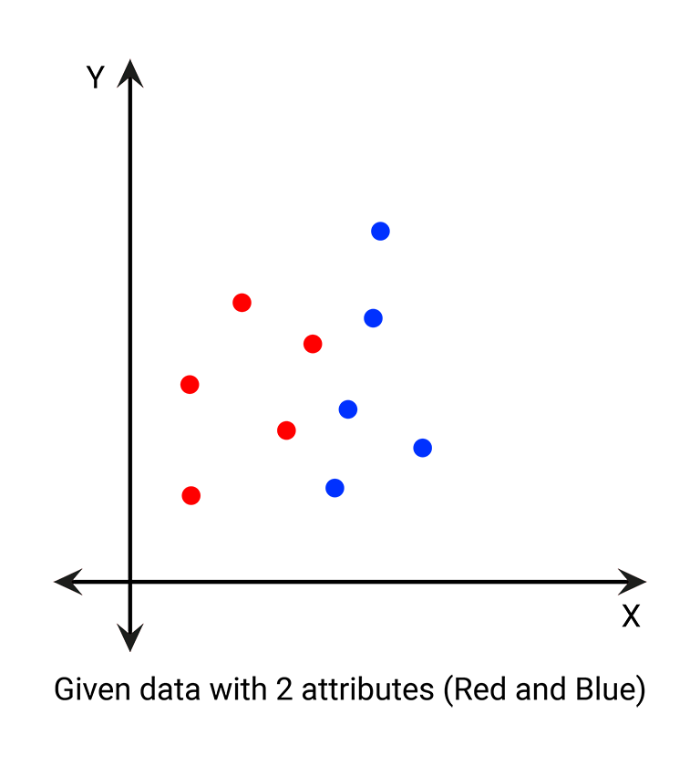
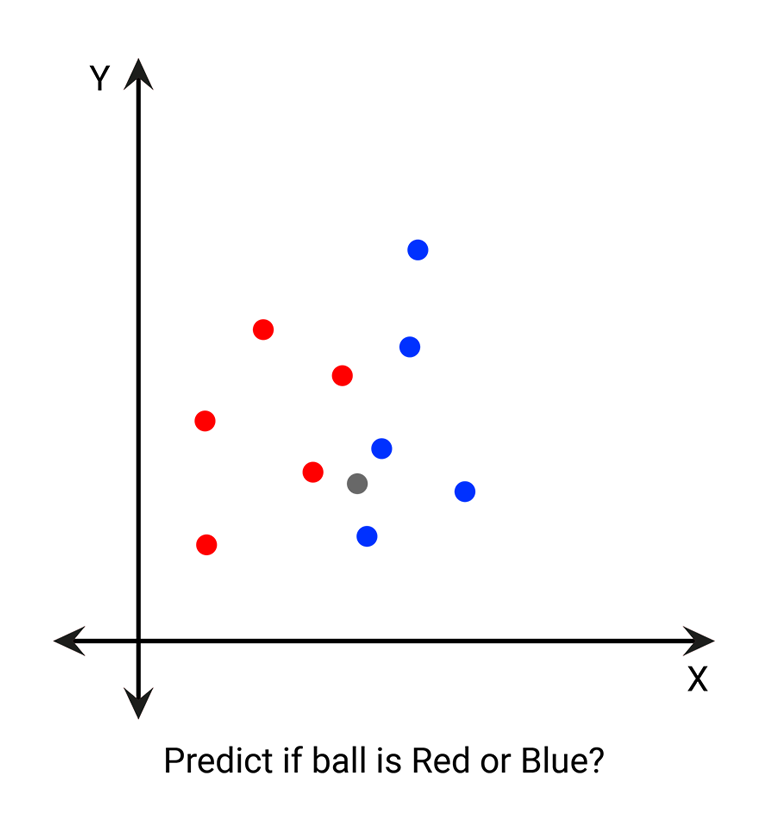
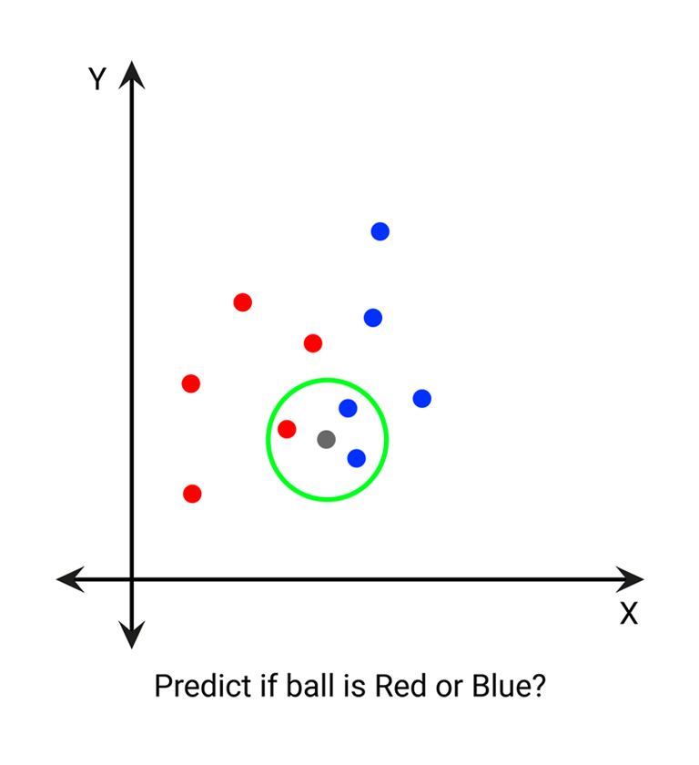
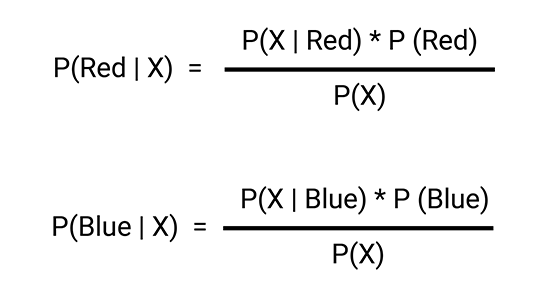
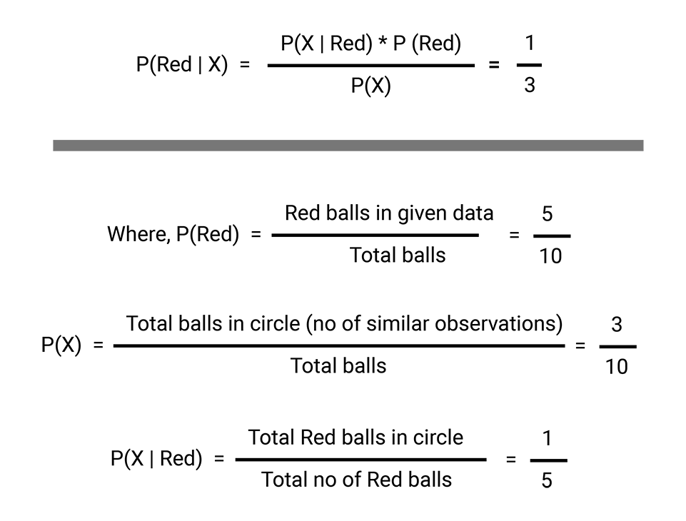

# Naive Bayes Classification

## Table of Contents

- [Overview](#overview)
- [Theory](#theory)
  - [Naive Bayes Intuition](#naive-bayes-intuition)
  - [Bayes Theorem](#bayes-theorem)
- [References](#references)

## Overview

Naive Bayes is a family of simple yet effective probabilistic classifiers based on applying Bayes' theorem with strong (naive) independence assumptions between features. It is widely used for classification tasks such as spam detection, document categorization, and more.

**Mathematical Intuition:**
- Naive Bayes assumes all features are independent given the class label (the "naive" assumption).
- The model uses Bayes' theorem:
  $$ P(c|x) = \frac{P(x|c)P(c)}{P(x)} $$
- In practice, $P(x|c)$ is computed as the product of the probabilities of each feature given the class.

## Theory

### Naive Bayes Intuition

We have data as shown below:

Suppose we want to predict if the ball (X) is red or blue:
1. Define radius r.
2. Draw a circle with radius r and center as (a, b).

We then calculate the probabilities:
- $P(\text{Red} | X)$: Probability of Red given X
- $P(\text{Blue} | X)$: Probability of Blue given X

Where:
- $P(\text{Red})$ is the prior probability of the class
- $P(x)$ is the prior probability of the predictor (marginal likelihood)
- $P(x | \text{Red})$ is the likelihood (probability of predictor given class)
- $P(c|x)$ is the posterior probability of class given predictor

If $P(\text{Red} | X) = 0.333$ and $P(\text{Blue} | X) = 0.666$, then X is more likely to be blue.

## References

- [An Introduction to the Naive-Bayes Algorithm (Towards Data Science)](https://towardsdatascience.com/an-introduction-to-the-naive-bayes-algorithm-be3bd692273e)
- [How I was using Naive Bayes (Incorrectly) till now (Towards Data Science)](https://towardsdatascience.com/how-i-was-using-naive-bayes-incorrectly-till-now-part-2-d31feff72483)
- [Naive Bayes Classifiers (GeeksforGeeks)](https://www.geeksforgeeks.org/naive-bayes-classifiers/)
- [scikit-learn GaussianNB Documentation](https://scikit-learn.org/stable/modules/generated/sklearn.naive_bayes.GaussianNB.html)
- [R e1071::naiveBayes Documentation](https://www.rdocumentation.org/packages/e1071/topics/naiveBayes)
