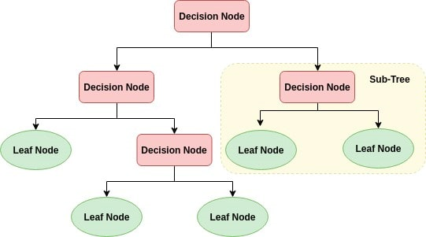

# Decision Tree Classification

> This lesson demonstrates how to preprocess data and apply Decision Tree Classification in both Python and R.

## Table of Contents

- [Overview](#overview)
- [Theory](#theory)
  - [How Decision Trees Work](#how-decision-trees-work)
- [References](#references)

## Overview

A Decision Tree is a supervised learning algorithm used for classification and regression tasks. It works by asking a series of questions about the dataset, splitting the data at each node based on feature values, and following the branches until a decision (class) is reached.

## Theory

### How Decision Trees Work

A Decision Tree is built by asking a series of questions about the dataset. Each time a response is obtained, a follow-up question is asked until a consensus about the record's class is reached.

**Mathematical Intuition:**
- At each node, the algorithm selects the feature and threshold that best splits the data, often using metrics like Gini impurity or information gain (entropy).
- The process continues recursively, creating branches until a stopping criterion is met (e.g., all samples in a node belong to the same class).
- The tree structure can be interpreted as a set of nested if-else rules.

If you haven't seen decision tree regression, check out the [Decision Tree Regression in R](https://github.com/tyrion404/ML-Decision-Tree-Regression-in-R) or [Decision Tree Regression in Python](https://github.com/tyrion404/ML-Decision-Tree-Regression-in-python).

## References

- Machine Learning, Tom Mitchell, McGraw Hill (Book)
- [scikit-learn DecisionTreeClassifier Documentation](https://scikit-learn.org/stable/modules/generated/sklearn.tree.DecisionTreeClassifier.html)
- [R rpart::rpart Documentation](https://www.rdocumentation.org/packages/rpart/topics/rpart)
