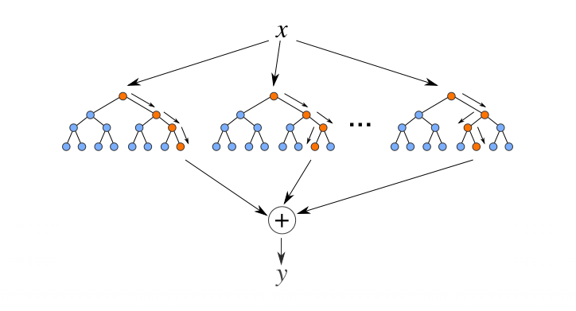

# Random Forest Classification

## Table of Contents

- [Overview](#overview)
- [Theory](#theory)
  - [How Random Forest Works](#how-random-forest-works)
- [References](#references)

## Overview

Random Forest is an ensemble learning algorithm that builds a "forest" of decision trees and combines their predictions to improve accuracy and reduce overfitting. It is widely used for classification and regression tasks.

## Theory

### How Random Forest Works

- A Random Forest creates multiple decision trees using different samples of the data and features.
- Each tree makes its own prediction, and the final prediction is made by averaging (regression) or majority voting (classification) across all trees.
- The averaging/voting makes Random Forest more robust and accurate than a single decision tree.

**Mathematical Intuition:**

- Each tree is trained on a random subset of the data (bagging) and a random subset of features, reducing overfitting and increasing diversity among trees.
- The ensemble approach leverages the "wisdom of the crowd"—errors from individual trees tend to cancel out.

## References

- Machine Learning, Tom Mitchell, McGraw Hill (Book)
- [scikit-learn RandomForestClassifier Documentation](https://scikit-learn.org/stable/modules/generated/sklearn.ensemble.RandomForestClassifier.html)
- [R randomForest Documentation](https://www.rdocumentation.org/packages/randomForest/topics/randomForest)
