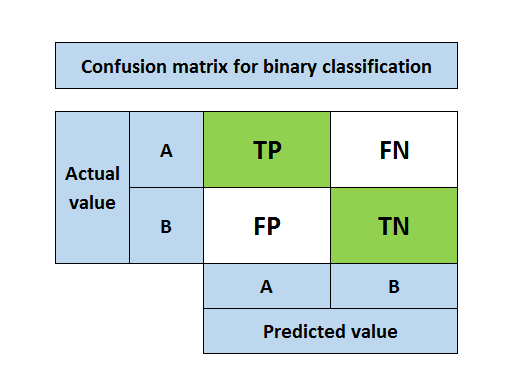
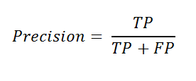
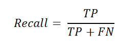
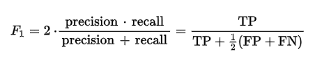
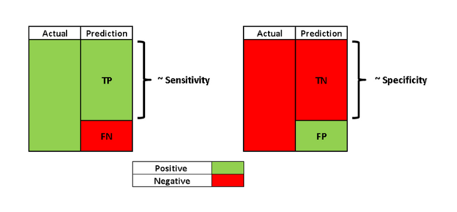

# Model Selection and Evaluating Classification Models Performance

## Table of Contents

- [Overview](#overview)
- [Evaluating Classification Models Performance](#evaluating-classification-models-performance)
  - [Classification Accuracy](#classification-accuracy)
  - [Confusion Matrix](#confusion-matrix)
  - [Precision and Recall](#precision-and-recall)
  - [F1 Score](#f1-score)
  - [Sensitivity and Specificity](#sensitivity-and-specificity)
  - [ROC Curve and AUC](#roc-curve-and-auc)
- [Model Selection](#model-selection)
- [References](#references)

## Overview

This section provides guidance on evaluating the performance of classification models and selecting the most suitable model for your data. You will find code templates and explanations for common evaluation metrics.

## Evaluating Classification Models Performance

### 1. Classification Accuracy

The accuracy of classification indicates how many of the predictions were accurate (True predictions / Total predictions).

### 2. Confusion Matrix

- **True positive (TP):** Predicting positive class as positive (ok)
- **False positive (FP):** Predicting negative class as positive (not ok)
- **False negative (FN):** Predicting positive class as negative (not ok)
- **True negative (TN):** Predicting negative class as negative (ok)

The desired outcome is that the prediction and actual class are the same.

### 3. Precision and Recall

Precision and recall metrics go beyond classification accuracy and provide a more comprehensive view of model evaluation.

The focus of precision is positive predictions. It indicates how many positive predictions are true.

The focus of recall is actual positive classes. It indicates how many of the positive classes the model is able to predict correctly.

### 4. F1 Score

F1 score is the weighted average of precision and recall.

### 5. Sensitivity and Specificity

- **Sensitivity** (true positive rate, TPR) is the same as recall.
- **Specificity** is similar to sensitivity but focused on the negative class.

### 6. ROC Curve and AUC

ROC (receiver operating characteristics) curve and AUC (area under the curve) are best explained with a logistic regression example. See this [article](https://towardsdatascience.com/how-to-best-evaluate-a-classification-model-2edb12bcc587) for details.

## Model Selection

You can use code templates of different classification models provided in the `model_selection/` folder and choose one which is suitable for your data. To use these templates, the dependent variable has to be in the last column.

## References

- Machine Learning, Tom Mitchell, McGraw Hill (Book)
