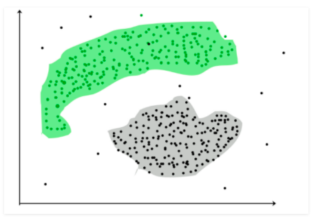

# Clustering

> Clustering is the process of grouping data points so that those in the same group (cluster) are more similar to each other than to those in other groups. It is a core unsupervised machine learning technique for discovering structure in unlabeled data.

## Table of Contents

- [Overview](#overview)
- [Key Terminologies](#key-terminologies)
- [Types of Clustering](#types-of-clustering)
- [Further Reading](#further-reading)

## Overview

Clustering algorithms automatically discover natural groupings in data. These methods are widely used for:

- Market segmentation
- Social network analysis
- Image and document classification
- Anomaly detection

**Use Cases:**
- Customer segmentation for marketing
- Organizing large document collections
- Detecting abnormal patterns in network traffic

## Key Terminologies

- **Cluster**: A collection of data points aggregated together due to certain similarities.
- **Centroid**: The center of a cluster (used in algorithms like K-Means).
- **Dendrogram**: A tree-like diagram that records the sequences of merges or splits (used in hierarchical clustering).

**Mathematical Intuition:**
- Clustering seeks to partition data so that points within a cluster are more similar to each other than to those in other clusters, often using a distance metric (e.g., Euclidean distance).
- The number of clusters (K) may be chosen in advance or determined by the algorithm.

## Types of Clustering

This section covers two well-known clustering methods:

1. **K-Means Clustering** ([see details](k_means_clustering/README.md))
2. **Hierarchical Clustering** ([see details](hierarchical_clustering/README.md))

Each method has its own strengths and is suited for different types of data and problem statements.

## Further Reading

- [Clustering in Machine Learning - GeeksforGeeks](https://www.geeksforgeeks.org/clustering-in-machine-learning/)
