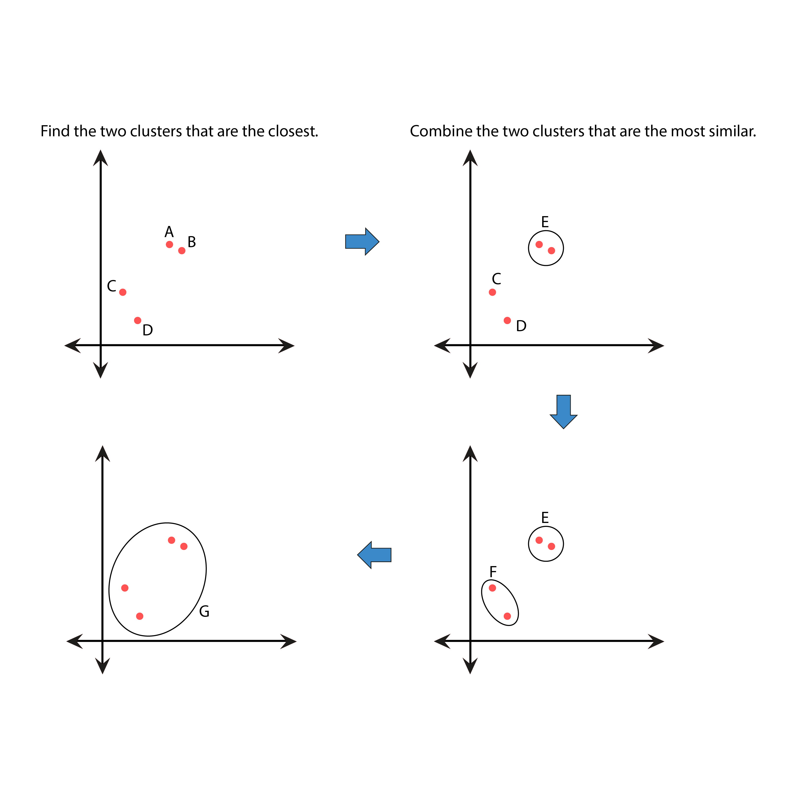
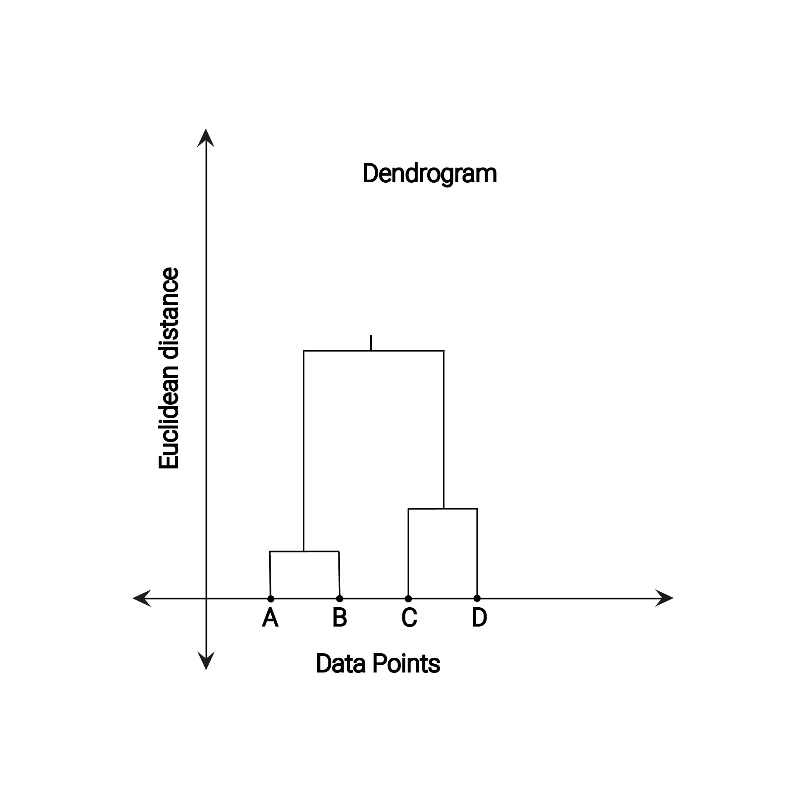

# Hierarchical Clustering

## Table of Contents

- [Overview](#overview)
- [How It Works](#how-it-works)
- [Types of Hierarchical Clustering](#types-of-hierarchical-clustering)
- [Distance Metrics](#distance-metrics)
- [References & Further Reading](#references--further-reading)

## Overview

Hierarchical clustering is a popular unsupervised machine learning technique used to group data points into clusters based on their similarity. Unlike partition-based methods (like K-Means), hierarchical clustering does not require specifying the number of clusters in advance and produces a dendrogram representing the nested grouping of patterns and similarity levels.

## How It Works

1. **Initialization:** Start with each observation as its own cluster.
2. **Iterative Merging:**
    - Find the two clusters that are closest together (according to a chosen distance metric).
    - Merge these two clusters into a single cluster.
    - Repeat until all data points are merged into a single cluster or until a stopping criterion is met.

  
  

The distance between two clusters is typically computed as the length of the straight line (Euclidean distance) between their centroids or members, depending on the linkage method.

**Mathematical Intuition:**
- The algorithm builds a tree (dendrogram) by iteratively merging or splitting clusters based on a distance metric.
- The height at which two clusters are joined reflects their similarity: lower means more similar.

## Types of Hierarchical Clustering

- **Agglomerative (Bottom-Up):**
  - Each observation starts in its own cluster, and pairs of clusters are merged as one moves up the hierarchy.
  - This is the most common approach and the focus of this lesson.
- **Divisive (Top-Down):**
  - All observations start in one cluster, and splits are performed recursively as one moves down the hierarchy.

## Distance Metrics

The choice of distance metric and linkage method affects the resulting clusters. Common options include:
- **Single Linkage:** Minimum distance between points in two clusters.
- **Complete Linkage:** Maximum distance between points in two clusters.
- **Average Linkage:** Average distance between all pairs of points in two clusters.
- **Ward's Method:** Minimizes the total within-cluster variance.

## References & Further Reading

- [What is Hierarchical Clustering? (Displayr)](https://www.displayr.com/what-is-hierarchical-clustering/#:~:text=Hierarchical%20clustering%2C%20also%20known%20as,broadly%20similar%20to%20each%20other.)
- [Hierarchical Clustering in Data Mining (GeeksforGeeks)](https://www.geeksforgeeks.org/hierarchical-clustering-in-data-mining/)
