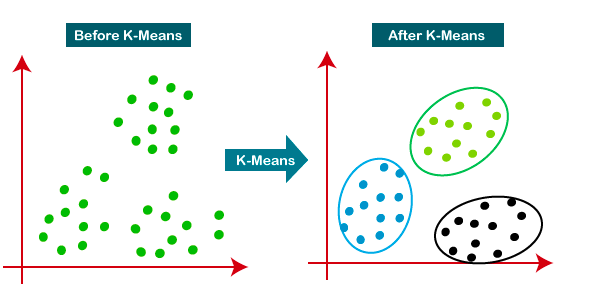
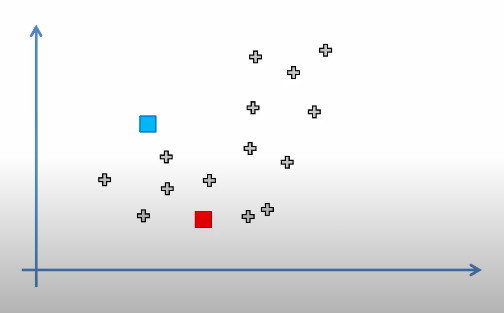
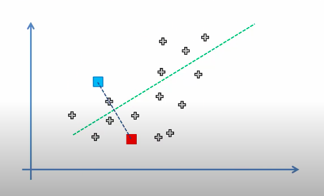
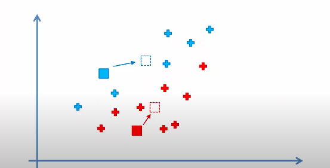
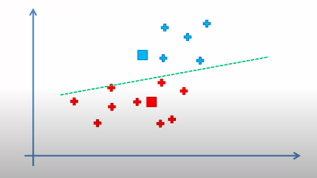

# K-Means Clustering

## Table of Contents

- [Overview](#overview)
- [Algorithm Steps](#algorithm-steps)
- [Code Example](#code-example)
- [When to Stop?](#when-to-stop)
- [Further Reading](#further-reading)

## Overview

K-Means Clustering is an unsupervised learning algorithm that partitions a dataset into **K** distinct, non-overlapping clusters. Each cluster is defined by its centroid (mean), and each data point is assigned to the cluster with the nearest centroid.

- **K**: The number of clusters to form, specified in advance (e.g., K=2 creates two clusters).

## Algorithm Steps

1. **Select the number of clusters (K)** and initialize centroids.
   
2. **Assign each data point to the nearest centroid.**
   
3. **Update centroids** by calculating the mean of all points assigned to each cluster.
   
4. **Repeat assignment and update steps** until convergence (no change in assignments or centroids).
   

**Mathematical Intuition:**

- The algorithm minimizes the sum of squared distances between each point and its assigned centroid.
- The objective function is: $\sum_{i=1}^K \sum_{x \in C_i} ||x - \mu_i||^2$, where $C_i$ is the set of points in cluster $i$ and $\mu_i$ is the centroid.

## When to Stop?

- When centroids do not change between iterations (convergence).
- When a maximum number of iterations is reached.

## Further Reading

- [Understanding K-means Clustering in Machine Learning – towardsdatascience.com](https://towardsdatascience.com/understanding-k-means-clustering-in-machine-learning-6a6e67336aa1)
- [K-means Clustering – Introduction – geeksforgeeks](https://www.geeksforgeeks.org/k-means-clustering-introduction/)
