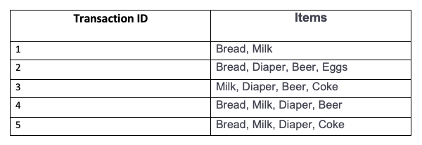

# Association Rule Learning

> Association Rule Learning uncovers interesting relationships, patterns, and associations among sets of items in large datasets. It is widely used for market basket analysis and transactional data mining.

## Table of Contents

- [Overview](#overview)
- [Key Terminologies](#key-terminologies)
- [Popular Algorithms](#popular-algorithms)
- [Example](#example)
- [Further Reading](#further-reading)

## Overview

Association rule learning finds rules that predict the occurrence of an item based on the presence of other items in a transaction. It is especially useful when features are binary (e.g., purchased/not purchased).

**Use Cases:**
- Market basket analysis (retail)
- Recommendation systems
- Web usage mining

## Key Terminologies

- **Support**: Frequency of occurrence of an itemset in the dataset.
- **Confidence**: Likelihood that item Y is also bought when item X is bought (conditional probability).
- **Lift**: Ratio of observed support to that expected if X and Y were independent. Indicates correlation.

**Mathematical Intuition:**
- The strength of a rule is measured by support, confidence, and lift:
  - **Support:** $P(A \cap B)$, the probability both items occur together.
  - **Confidence:** $P(B|A)$, the probability of B given A.
  - **Lift:** $\frac{P(A \cap B)}{P(A)P(B)}$, measures how much more likely A and B occur together than if independent.

## Popular Algorithms

- **Apriori** ([see details](apriori/README.md))
- **ECLAT** ([see details](eclat/README.md))

## Example

Given transactions, a rule like `{Beer, Diaper} -> {Milk}` means those who buy beer and diaper also tend to buy milk.

- Support for the rule: 2/5
- Confidence for the rule: 2/3

If lift < 1: negative correlation; = 1: no correlation; > 1: positive correlation.

## Further Reading

- [Association Rule Mining - Towards Data Science](https://towardsdatascience.com/association-rule-mining-be4122fc1793)
- [Association Rule - GeeksforGeeks](https://www.geeksforgeeks.org/association-rule/)
