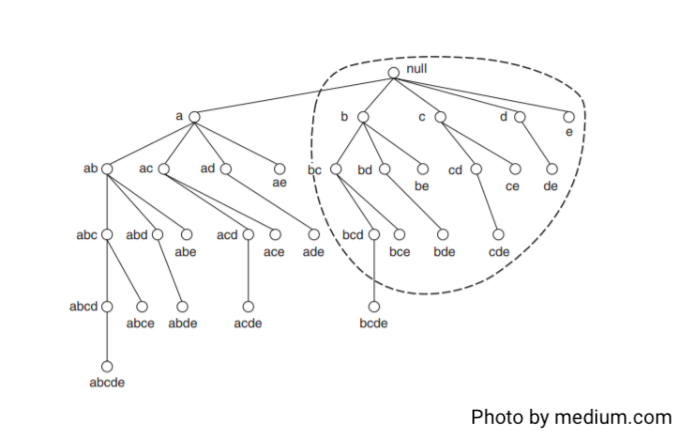

# ECLAT Algorithm

> **ECLAT** stands for *Equivalence Class Clustering and bottom-up Lattice Traversal*.

## Table of Contents

- [Overview](#overview)
- [Algorithm Steps](#algorithm-steps)
- [Visualization](#visualization)
- [Further Reading](#further-reading)

## Overview

ECLAT is a fast algorithm for mining frequent itemsets and association rules, working in a vertical data format. Unlike Apriori, ECLAT uses transaction ID sets (tidsets) and set intersections to efficiently compute support, traversing the itemset lattice in a depth-first manner.

## Algorithm Steps

- Start with single items and their tidsets.
- Recursively intersect tidsets to generate candidate itemsets and compute their support.
- Prune itemsets that do not meet the minimum support threshold.
- Continue depth-first traversal until no further frequent itemsets can be found.

**Mathematical Intuition:**
- Represents itemsets as sets of transaction IDs (tidsets).
- Finds frequent itemsets by intersecting tidsets, which is computationally efficient for dense datasets.

## Visualization

## Further Reading

- [Association Rule Mining using ECLAT Algorithm – Medium](https://medium.com/machine-learning-and-artificial-intelligence/3-4-association-rule-mining-using-eclat-algorithm-b6e50aab2147)
- [ML | ECLAT Algorithm – GeeksforGeeks](https://www.geeksforgeeks.org/ml-eclat-algorithm/#:~:text=The%20ECLAT%20algorithm%20stands%20for,version%20of%20the%20Apriori%20algorithm.)
