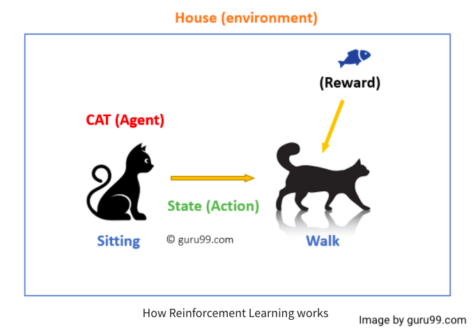

# Reinforcement Learning

> Reinforcement Learning (RL) is a type of machine learning where an agent learns to make decisions by interacting with an environment to maximize cumulative reward.

## Table of Contents

- [Overview](#overview)
- [Key Terminologies](#key-terminologies)
- [How It Works](#how-it-works)
- [Popular Algorithms](#popular-algorithms)
- [Example](#example)
- [Further Reading](#further-reading)

## Overview

Reinforcement learning is about learning what to do—how to map situations to actions—so as to maximize a numerical reward signal. The agent learns by trial and error, receiving feedback from its own actions and experiences.

**Use Cases:**
- Game playing (e.g., AlphaGo, chess, video games)
- Robotics (learning to walk, grasp, or navigate)
- Dynamic pricing and recommendation systems

## Key Terminologies

- **Agent**: The learner or decision maker (e.g., a robot, software, or animal).
- **Environment**: The world the agent interacts with.
- **State**: The current situation of the agent.
- **Action**: Choices made by the agent.
- **Reward**: Feedback from the environment.
- **Policy**: The strategy used by the agent to determine actions.

**Mathematical Intuition:**
- The agent seeks to maximize the expected sum of rewards over time, often using algorithms like Q-learning or policy gradients.
- The process is modeled as a Markov Decision Process (MDP), with states, actions, rewards, and transitions.

## How It Works

1. The agent observes the current state.
2. It selects and performs an action.
3. The environment responds with a new state and a reward.
4. The agent updates its knowledge and repeats the process.

The goal is to learn a policy that maximizes the total reward over time.

## Popular Algorithms

- **Upper Confidence Bound (UCB)** ([see details](upper_confidence_bound/README.md))
- **Thompson Sampling** ([see details](thompson_sampling/README.md))

## Example

A cat (agent) in a home (environment) learns to walk (action) when you use a specific word (state), and gets a treat (reward) for doing so. Over time, the cat learns which actions yield the best rewards.

## Further Reading

- [Reinforcement Learning – GeeksforGeeks](https://www.geeksforgeeks.org/what-is-reinforcement-learning/)
