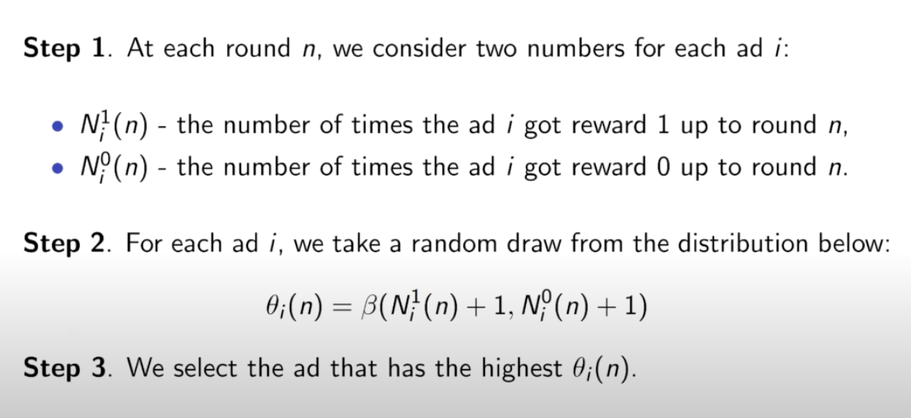

# Thompson Sampling

> **Thompson Sampling** (also known as Posterior Sampling or Probability Matching) is a powerful algorithm for solving the Multi-Armed Bandit problem by balancing exploration and exploitation to maximize cumulative rewards.

## Table of Contents
- [Overview](#overview)
- [Algorithm Steps](#algorithm-steps)
- [Visualization](#visualization)
- [Further Reading](#further-reading)

## Overview
Thompson Sampling is a Bayesian approach to the exploration-exploitation dilemma. It selects actions according to their probability of being optimal, based on observed rewards. This makes it highly effective for online decision-making problems such as ad placement, recommendation systems, and clinical trials.

- **Exploration:** Trying new actions to gather more information.
- **Exploitation:** Choosing actions that have performed well in the past to maximize reward.

## Algorithm Steps
1. For each action, maintain a probability distribution (posterior) over its expected reward.
2. At each round, sample a value from each action's posterior distribution.
3. Select the action with the highest sampled value.
4. Observe the reward and update the posterior for the selected action.
5. Repeat for the desired number of rounds.

**Mathematical Intuition:**
- Maintains a probability distribution (posterior) for each action's reward, updating it as new data arrives.
- Randomly samples from these distributions to decide which action to try, naturally balancing exploration and exploitation.

## Visualization

## Further Reading
- [Thompson Sampling – Wikipedia](https://en.wikipedia.org/wiki/Thompson_sampling)
- [A Tutorial on Thompson Sampling – Stanford](https://web.stanford.edu/~bvr/pubs/TS_Tutorial.pdf)
