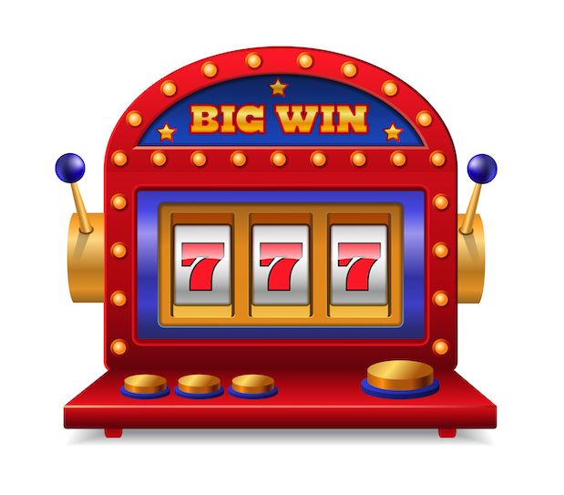
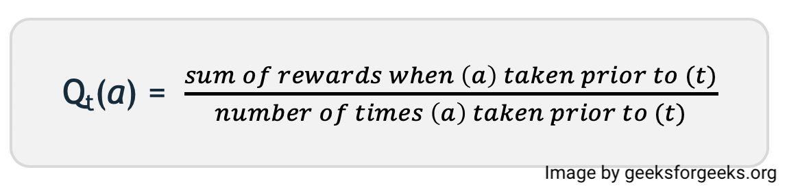
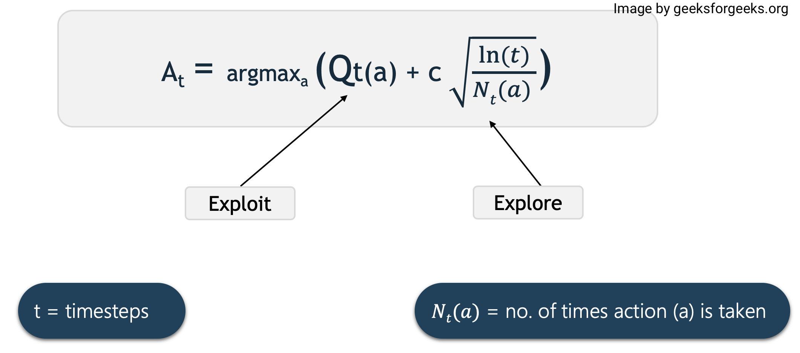

# Upper Confidence Bound (UCB)

> **UCB** is a classic algorithm for solving the Multi-Armed Bandit problem, balancing exploration and exploitation using the principle of optimism in the face of uncertainty.

## Table of Contents

- [Overview](#overview)
- [Exploration vs Exploitation](#exploration-vs-exploitation)
- [Algorithm Steps](#algorithm-steps)
- [Visualizations](#visualizations)
- [Further Reading](#further-reading)

## Overview

The Multi-Armed Bandit problem models a scenario where an agent must choose between multiple options (slot machine levers), each with an unknown reward distribution, to maximize total reward over time.

## Exploration vs Exploitation

- **Greedy Action:** Selects the action with the highest estimated value (exploitation).
- **Non-Greedy Action:** Selects other actions to learn more about their rewards (exploration).
- **Exploration:** Helps the agent discover potentially better actions.
- **Exploitation:** Focuses on maximizing immediate reward based on current knowledge.

## Algorithm Steps

1. For each action, keep track of the number of times it has been selected and its average reward.
2. At each round, calculate the upper confidence bound for each action:
   - UCB = average reward + confidence interval (uncertainty term)
3. Select the action with the highest UCB value.
4. Update the statistics for the selected action based on the observed reward.
5. Repeat for the desired number of rounds.

**Mathematical Intuition:**
- UCB selects actions based on both their estimated value and an uncertainty term, encouraging exploration of less-tried options.
- The confidence bound grows smaller as an action is tried more, balancing exploration and exploitation mathematically.

## Visualizations

*The image above depicts a two-lever slot machine (bandit). Each lever has its own reward distribution. The goal is to identify the lever with the highest expected reward.*

*Sample-average method for estimating action values.*

*UCB action selection balances exploration and exploitation by considering uncertainty in action-value estimates.*

## Further Reading

- [Upper Confidence Bound Algorithm in Reinforcement Learning – GeeksforGeeks](https://www.geeksforgeeks.org/upper-confidence-bound-algorithm-in-reinforcement-learning/)
