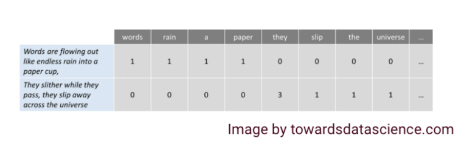

# Natural Language Processing (NLP)

> Natural Language Processing (NLP) is a field of Artificial Intelligence that enables machines to read, understand, and derive meaning from human language.

## Table of Contents

- [Overview](#overview)
- [Key Terminologies](#key-terminologies)
- [Bag of Words](#bag-of-words)
- [Visualization](#visualization)
- [Further Reading](#further-reading)

## Overview

NLP combines computational linguistics, machine learning, and deep learning models to process and analyze large amounts of natural language data. Common applications include:
- Text classification
- Sentiment analysis
- Machine translation
- Chatbots

**Use Cases:**
- Spam detection
- Virtual assistants (e.g., Siri, Alexa)
- Language translation

## Key Terminologies

- **Tokenization**: Splitting text into words, phrases, or symbols.
- **Stopwords**: Common words (e.g., "the", "a", "an") often removed from text.
- **Bag of Words**: A model that represents text as a set of word occurrences, ignoring grammar and word order.

**Mathematical Intuition:**
- Text is converted into numerical representations (e.g., Bag of Words, TF-IDF, word embeddings) for algorithms to process.
- Probabilistic models and neural networks are used to capture the structure and meaning of language.

## Bag of Words

A widely used model for converting text into a matrix of word occurrences. The frequency of these words is then used as features for training a classifier.

## Visualization

## Further Reading

- [Your Guide to Natural Language Processing (NLP) – Towards Data Science](https://towardsdatascience.com/your-guide-to-natural-language-processing-nlp-48ea2511f6e1)
