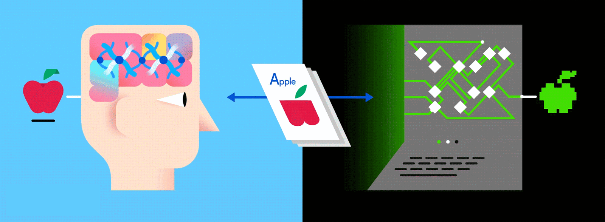

# Deep Learning

> Deep Learning is a subset of machine learning inspired by the structure and function of the human brain, using multi-layered neural networks to analyze data and make predictions.

## Table of Contents

- [Overview](#overview)
- [Key Terminologies](#key-terminologies)
- [How It Works](#how-it-works)
- [Visualization](#visualization)
- [Further Reading](#further-reading)

## Overview

Deep learning algorithms use neural networks with many layers (deep neural networks) to automatically learn representations from data. They are especially powerful for tasks involving images, audio, and text.

**Use Cases:**
- Image and speech recognition
- Natural language processing
- Autonomous vehicles

## Key Terminologies

- **Neural Network**: A computational model inspired by the human brain, consisting of interconnected nodes (neurons).
- **Layer**: A collection of neurons operating at a particular depth in the network.
- **Activation Function**: A function that determines the output of a neuron.

## How It Works

**Mathematical Intuition:**
- Deep learning models are composed of layers of artificial neurons, each performing a weighted sum and activation function.
- The network learns by adjusting weights to minimize prediction error using backpropagation and optimization algorithms.

1. Data is passed through multiple layers of neurons.
2. Each layer transforms the data using weights, biases, and activation functions.
3. The network learns by adjusting weights to minimize prediction error (using backpropagation).

## Visualization

## Further Reading

- [What is Deep Learning and How does it work? – Towards Data Science](https://towardsdatascience.com/what-is-deep-learning-and-how-does-it-work-2ce44bb692ac)
