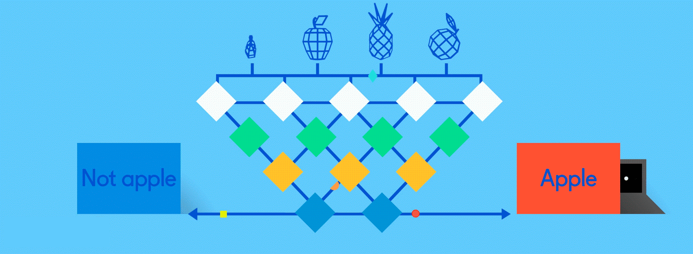
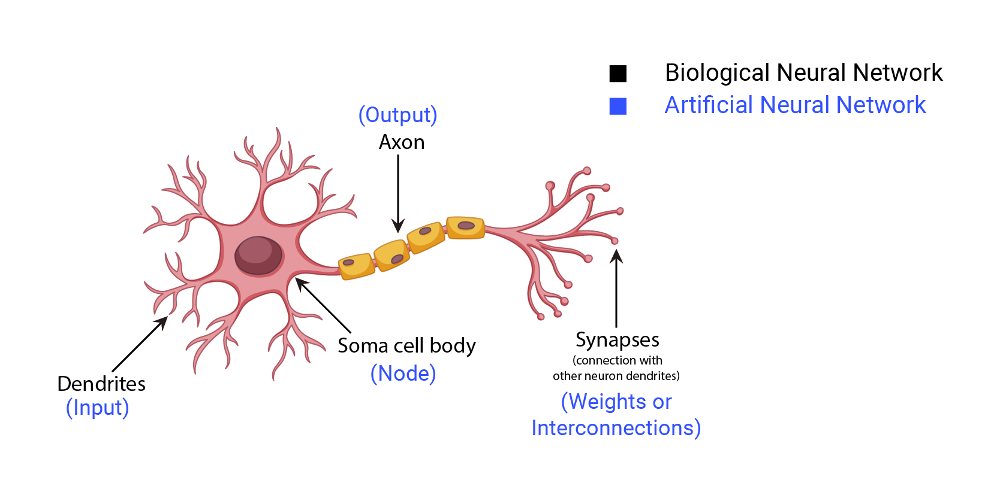
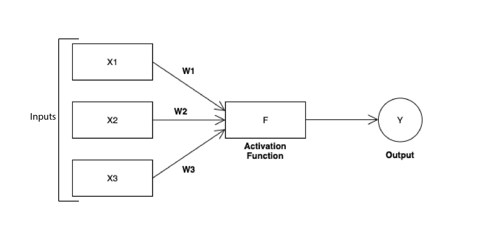
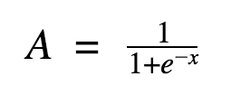
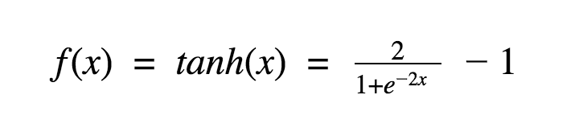
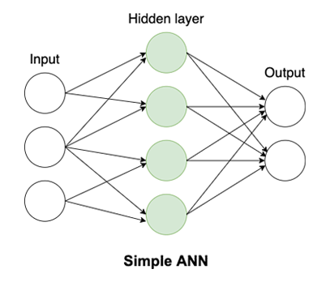
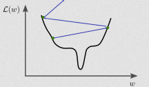

# Artificial Neural Network (ANN)

> “A computing system made up of a number of simple, highly interconnected processing elements, which process information by their dynamic state response to external inputs.” — Dr. Robert Hecht-Nielsen, inventor of the first neurocomputer

## Table of Contents

1. [Introduction](#introduction)
2. [The Neuron](#the-neuron)
3. [Activation Functions](#activation-functions)
4. [How Neural Networks Work](#how-neural-networks-work)
5. [How Neural Networks Learn](#how-neural-networks-learn)
6. [Gradient Descent](#gradient-descent)
7. [Stochastic Gradient Descent](#stochastic-gradient-descent)
8. [Backpropagation](#backpropagation)
9. [Further Reading](#further-reading)

## Introduction

Artificial Neural Networks (ANNs) are inspired by the structure and function of the human brain. They consist of interconnected nodes (neurons) that process information in layers, enabling powerful pattern recognition and learning capabilities.

**Use Cases:**

- Image and speech recognition
- Fraud detection
- Medical diagnosis

## The Neuron

The neuron is the fundamental unit of both biological and artificial neural networks.

- **Biological vs. Artificial Neuron:**
  
- **ANN Model:**
  
- A network of neurons (nodes) forms a neural network, which is more powerful than a single neuron.

## Activation Functions

Activation functions determine the output of a neural network node. They can be:

1. **Linear Activation Function**
2. **Non-linear Activation Functions**

### Common Activation Functions

- **Step Function:** Activates output if input exceeds a threshold.
- **Linear Function:** Output is proportional to input.
- **Sigmoid Function:** Nonlinear, outputs values between 0 and 1.
  
- **Tanh Function:** Similar to sigmoid, outputs between -1 and 1.
  
- **ReLU Function:** Output is `max(0, x)`.

**Tip:** If unsure, start with ReLU and adjust based on your problem.

## How Neural Networks Work

Neural networks make decisions by:

1. Multiplying inputs by their respective weights.
2. Summing the weighted inputs.
3. Applying an activation function.

Complex networks use multiple layers to make more sophisticated decisions.

**Mathematical Intuition:**
- Each neuron computes a weighted sum of its inputs, applies an activation function, and passes the result to the next layer.
- The network learns by adjusting weights to minimize prediction error, typically using backpropagation and gradient descent.

## How Neural Networks Learn

Neural networks typically learn via supervised learning:

- Start with random weights and biases.
- Adjust weights using optimization techniques based on training data and error feedback.

Key techniques include:

- Gradient Descent
- Stochastic Gradient Descent
- Backpropagation

## Gradient Descent

Gradient descent is an optimization algorithm used to minimize the loss function by iteratively adjusting weights and biases.

- The process involves calculating gradients and updating parameters to move towards the global minimum of the loss function.

## Stochastic Gradient Descent

Stochastic Gradient Descent (SGD) updates weights using a randomly selected subset of data (mini-batch), which can help escape local minima and speed up training.

## Backpropagation

Backpropagation is the process of propagating the error backward through the network to update weights efficiently using gradients.

- For more details, see: [Neural Networks and Deep Learning - Chapter 2](http://neuralnetworksanddeeplearning.com/chap2.html)

## Further Reading

- [Artificial Neural Network Basic Concepts - Tutorialspoint](https://www.tutorialspoint.com/artificial_neural_network/artificial_neural_network_basic_concepts.htm)
- [Understanding Activation Functions in Neural Networks - Medium](https://medium.com/the-theory-of-everything/understanding-activation-functions-in-neural-networks-9491262884e0)
- [Activation Functions - GeeksforGeeks](https://www.geeksforgeeks.org/activation-functions/#:~:text=The%20activation%20function%20is%20a,are%20used%20in%20Deep%20Learning.)
- [Activation Functions in Neural Networks - Towards Data Science](https://towardsdatascience.com/activation-functions-neural-networks-1cbd9f8d91d6)
- [How does a neural network learn? - Towards Data Science](https://towardsdatascience.com/how-does-a-neural-network-learn-f33bcff61026)
- [Understanding the Mathematics behind Gradient Descent - Towards Data Science](https://towardsdatascience.com/understanding-the-mathematics-behind-gradient-descent-dde5dc9be06e)
- [Stochastic Gradient Descent Clearly Explained! - Towards Data Science](https://towardsdatascience.com/stochastic-gradient-descent-clearly-explained-53d239905d31)
- [ML | Stochastic Gradient Descent (SGD) - GeeksforGeeks](https://www.geeksforgeeks.org/ml-stochastic-gradient-descent-sgd/)
- [Back Propagation Neural Network: Explained With Simple Example - Guru99](https://www.guru99.com/backpropogation-neural-network.html)
- Book: *A Neural Network in 13 Lines of Python* by Michael Nielsen
