# Convolutional Neural Network (ConvNet/CNN)

> A Convolutional Neural Network (ConvNet/CNN) is a Deep Learning algorithm that can take an input image, assign importance (learnable weights and biases) to various aspects/objects in the image, and distinguish between them.

## Table of Contents
1. [Introduction](#introduction)
2. [Image Preprocessing](#image-preprocessing)
3. [Steps in Convolutional Neural Networks](#steps-in-convolutional-neural-networks)
    - [Convolution Operation](#1-a-convolution-operation)
    - [ReLU Layer](#1-b-relu-layer)
    - [Pooling](#2-pooling)
    - [Flattening](#3-flattening)
    - [Full Connection](#4-full-connection)
4. [Further Reading](#further-reading)

## Introduction

Convolutional Neural Networks (CNNs) are inspired by the way our brains process visual information. They are especially powerful for tasks involving image recognition and classification, as they can automatically and adaptively learn spatial hierarchies of features from input images.

**Use Cases:**
- Image and video recognition
- Medical image analysis
- Object detection in self-driving cars

## Image Preprocessing

Before images are fed into a CNN, preprocessing is performed:
- **Scanning Images:**
  - Color images are scanned differently than black and white images.
  - Each pixel contains 8 bits (1 byte) of information, with colors represented on a scale from 0 to 255.
  - Computers process images as arrays of numbers, not as colors.
  - Example of a black and white image in bytes (black pixel as 1, white as 0):
    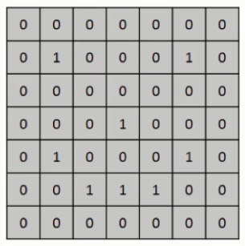

## Steps in Convolutional Neural Networks

1. **(A) Convolution Operation**
2. **(B) ReLU Layer**
3. **Pooling**
4. **Flattening**
5. **Full Connection**

**Mathematical Intuition:**
- Convolutional layers apply filters (kernels) that slide over the input, computing dot products to extract features.
- Pooling layers reduce dimensionality, and fully connected layers combine features for classification.

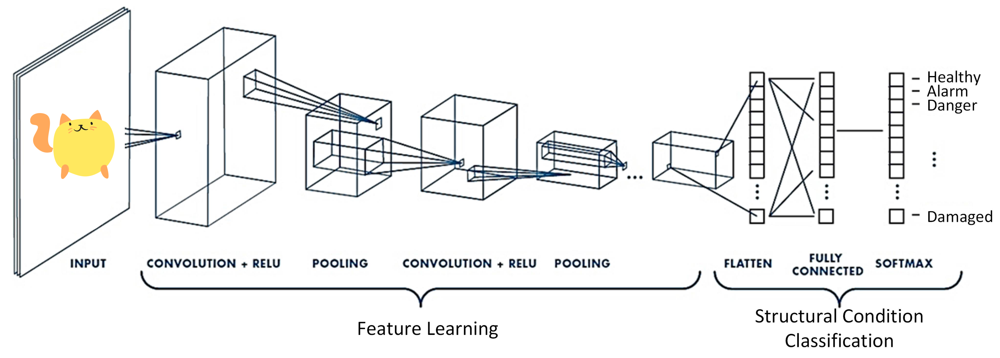

### 1 (A). Convolution Operation

Convolution is a mathematical operation that combines two functions to produce a third function expressing how the shape of one is modified by the other.

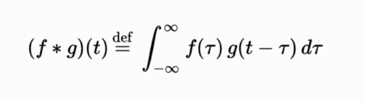

- **Components:**
  - Input image
  - Feature detector
  - Feature map
- For black and white images, a single matrix is used; for RGB images, three matrices (red, green, blue) are used.
- **Feature Detector Example:**
  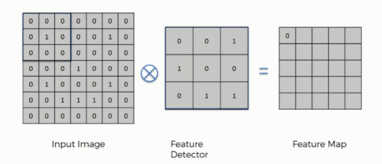
- **RGB Convolution Example:**
  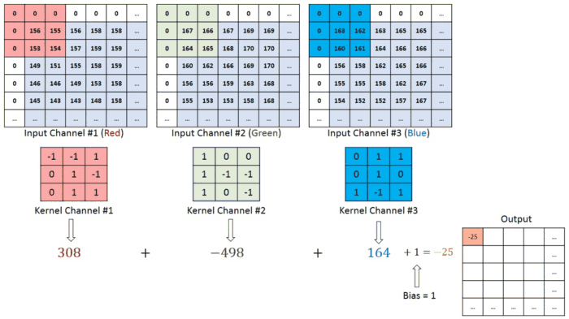
- **Feature Detector Animation:**
  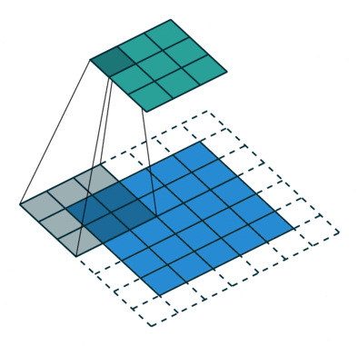
- Convolution reduces the size of the input image and helps the network focus on important features.
- Multiple feature detectors are used to create convolutional layers, allowing the network to learn which features are most important for classification.

### 1 (B). ReLU Layer

- The ReLU (Rectified Linear Unit) layer introduces non-linearity to the network, enabling it to learn complex patterns.
- If you are unfamiliar with ReLU, refer to the Artificial Neural Networks (ANN) section first.
- ReLU helps the network model non-linear features such as edges and colors.

### 2. Pooling

- Pooling layers reduce the dimensions of feature maps, making the model more robust to variations in feature positions.
- Example:
  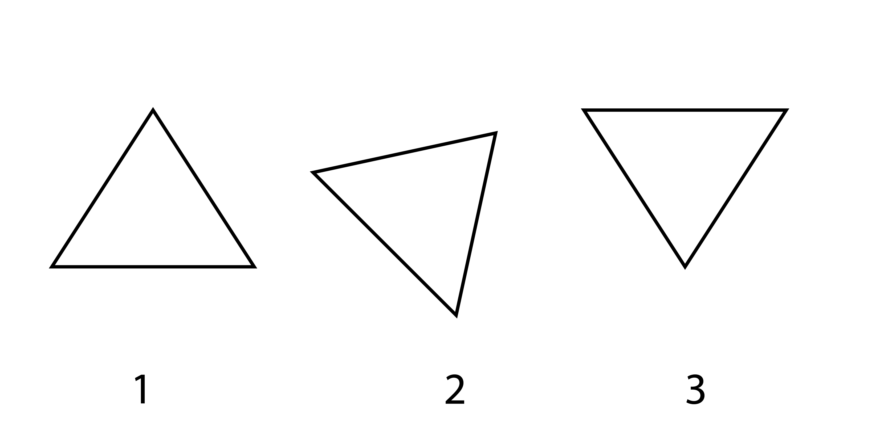
- **Types of Pooling:**
  1. Max Pooling: Returns the maximum value from the region covered by the kernel.
  2. Average Pooling: Returns the average value from the region.
- Max Pooling also acts as a noise suppressant and helps with dimensionality reduction.
- Example of pooling types:
  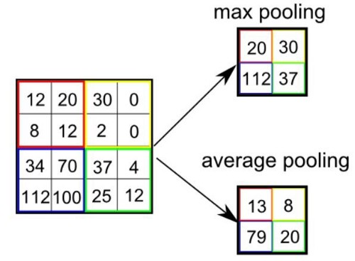

### 3. Flattening

- Flattening converts the pooled feature maps into a single column vector, which can then be fed into a fully connected layer.
  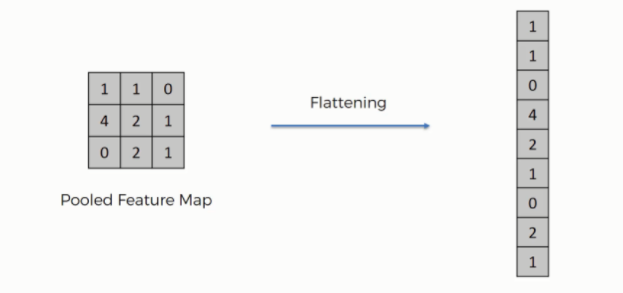
- This step prepares the data for further processing by the artificial neural network.

### 4. Full Connection

- In this stage, the network becomes more complex and sophisticated.
- The main distinction between an Artificial Neural Network (ANN) and a CNN is the presence of convolutional and pooling layers before the fully connected layers.
- Each neuron in the fully connected layer is connected to all activations in the previous layer.
  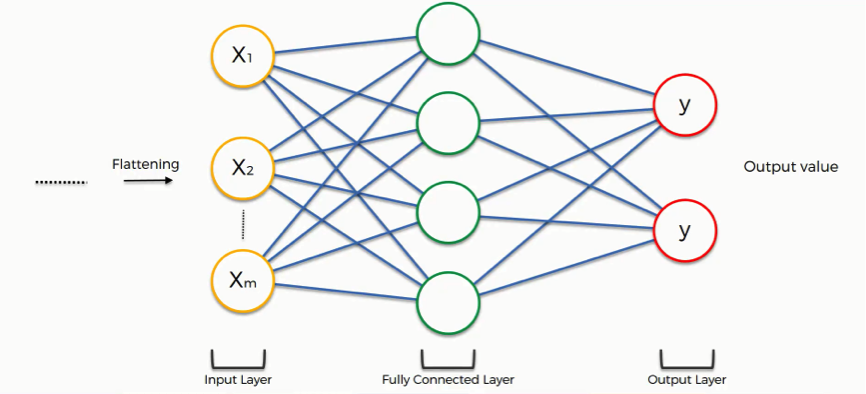
- The flattened output is fed to a feed-forward neural network, and backpropagation is used to adjust weights during training.
- The model learns to differentiate between dominant and low-level features in images, classifying them using the Softmax function:
  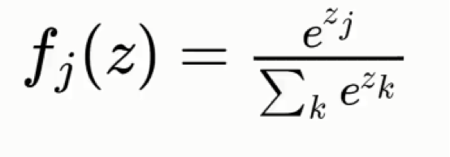
- **Loss Functions:**
  - Cross-Entropy is commonly used to evaluate network efficiency and optimize performance.
    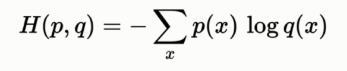

## Further Reading

- [Demo for guessing the number you draw](https://adamharley.com/nn_vis/cnn/2d.html)
- [Introduction to Convolutional Neural Networks by Jianxin Wu (PDF)](https://cs.nju.edu.cn/wujx/paper/CNN.pdf)
- [The Ultimate Guide to Convolutional Neural Networks (CNN) - SuperDataScience](https://www.superdatascience.com/blogs/the-ultimate-guide-to-convolutional-neural-networks-cnn)
- [A Comprehensive Guide to Convolutional Neural Networks — the ELI5 way - Towards Data Science](https://towardsdatascience.com/a-comprehensive-guide-to-convolutional-neural-networks-the-eli5-way-3bd2b1164a53)
- [An introduction to Convolutional Neural Networks — the ELI5 way - Towards Data Science](https://towardsdatascience.com/an-introduction-to-convolutional-neural-networks-eb0b60b58fd7)
