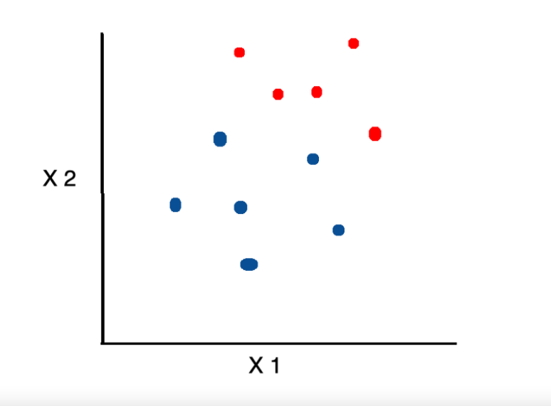
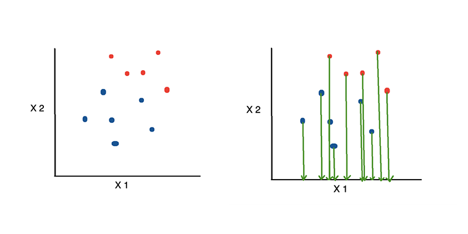
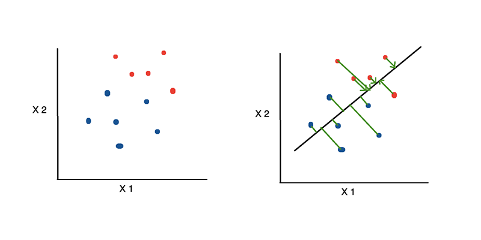

# Linear Discriminant Analysis (LDA)

> Linear Discriminant Analysis (LDA), also known as Normal Discriminant Analysis (NDA) or Discriminant Function Analysis, is a generalization of Fisher's linear discriminant. It is a statistical method used to find a linear combination of features that best separates two or more classes of objects or events.

## Table of Contents

1. [Introduction](#linear-discriminant-analysis-lda)
2. [How LDA Works](#how-lda-works)
3. [Further Reading](#further-reading)

## How LDA Works

- Suppose we plot two variables, each color representing a different class:
  
- If we want to reduce the number of dimensions to one, a simple approach is to project everything onto the x-axis:
  
- Linear Discriminant Analysis, however, uses information from both features to create a new axis that maximizes class separability, projecting the data onto this new axis:
  

**Mathematical Intuition:**
- LDA finds a linear combination of features that maximizes the distance between class means while minimizing the spread within each class.
- This is achieved by maximizing the ratio of between-class variance to within-class variance.

## Further Reading

- [Linear Discriminant Analysis, Explained - Towards Data Science](https://towardsdatascience.com/linear-discriminant-analysis-explained-f88be6c1e00b)
- [Linear Discriminant Analysis In Python - Towards Data Science](https://towardsdatascience.com/linear-discriminant-analysis-in-python-76b8b17817c2#:~:text=Linear%20Discriminant%20Analysis%20(LDA)%20is,as%20much%20information%20as%20possible.)
