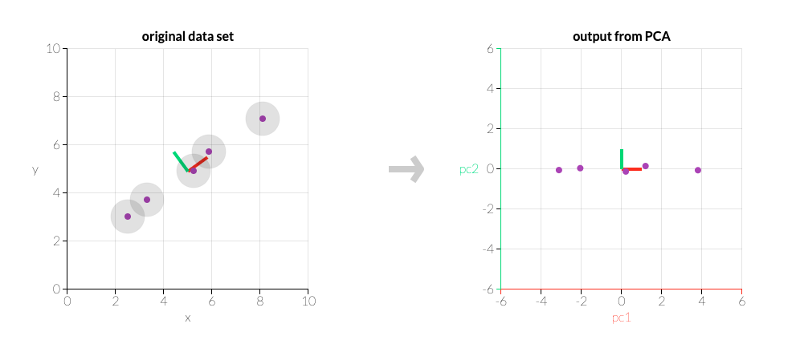

# Principal Component Analysis (PCA)

> Principal Component Analysis (PCA) is a technique for reducing the dimensionality of datasets, increasing interpretability while minimizing information loss. It does so by computing principal components and using them to transform the data, often retaining only the most significant components.

## Table of Contents

1. [Introduction](#principal-component-analysis-pca)
2. [When to Use PCA](#when-to-use-pca)
3. [How PCA Works](#how-pca-works)
4. [Further Reading](#further-reading)

## When to Use PCA

- When you want to reduce the number of variables but can't decide which ones to eliminate.
- When you want to ensure your variables are independent of one another.

## How PCA Works

- PCA creates a matrix summarizing how variables are related.
- The matrix is decomposed into direction and magnitude (principal components).
- Example: The two main directions in the data are shown below ("red direction" is more important):
  
  Image source: setosa.io
- The original data is transformed to align with these principal directions.

**Mathematical Intuition:**
- PCA finds new axes (principal components) that maximize the variance in the data, subject to being orthogonal to each other.
- The first principal component captures the most variance, the second the next most, and so on.
- Mathematically, this is done by eigenvalue decomposition of the covariance matrix.

## Further Reading
- [A One-Stop Shop for Principal Component Analysis - Towards Data Science](https://towardsdatascience.com/a-one-stop-shop-for-principal-component-analysis-5582fb7e0a9c)
- [setosa.io - Principal Component Analysis](https://setosa.io/ev/principal-component-analysis/)
