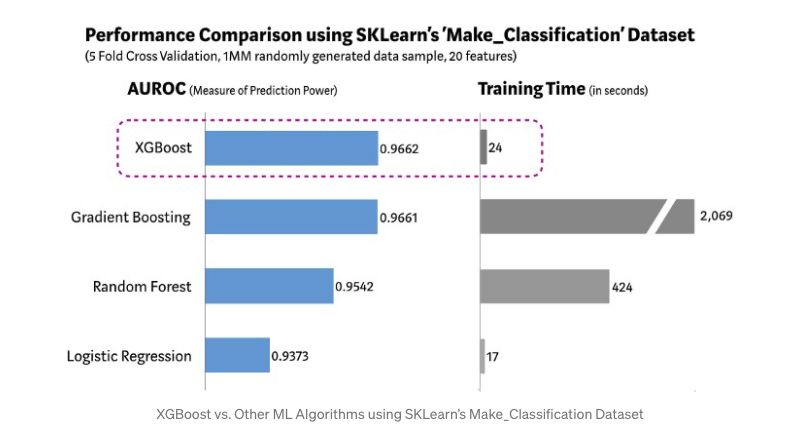

# XGBoost

> XGBoost is a high-performance, decision-tree-based ensemble Machine Learning algorithm that uses a gradient boosting framework for superior speed and accuracy.

## Table of Contents

- [Overview](#overview)
- [Key Features](#key-features)
- [How It Works](#how-it-works)
- [Visualization](#visualization)
- [Further Reading](#further-reading)

## Overview

XGBoost (Extreme Gradient Boosting) is widely used for structured/tabular data in machine learning competitions and real-world applications. It is known for its scalability, flexibility, and efficiency.

Common applications include:
- Regression
- Classification
- Ranking

## Key Features

- Supports all major programming languages
- Handles missing values
- Regularization to prevent overfitting
- Parallel and distributed computing
- Cloud integration (AWS, Azure, etc.)

## How It Works

1. Builds an ensemble of decision trees sequentially, where each new tree corrects errors from previous trees.
2. Uses gradient descent to minimize loss.
3. Employs regularization and advanced system optimizations for speed and accuracy.

## Visualization

## Further Reading

- [XGBoost Algorithm: Long May She Reign! – Towards Data Science](https://towardsdatascience.com/https-medium-com-vishalmorde-xgboost-algorithm-long-she-may-rein-edd9f99be63d)
- [XGBoost GitHub Repo](https://github.com/dmlc/xgboost)
